# Universalis Harness

**Un agente AI che lavora sui tuoi file, non solo in una chat.**
Dashboard web self-hosted: chat con tracciamento reale della spesa, file manager, obiettivi,
pianificazioni cron, skill riutilizzabili, memoria a lungo termine, browser pilotato e servizi
locali che si accendono a richiesta — un solo processo Node, nessun database, nessuna build.

   &nbsp;
   &nbsp;
   &nbsp;
   &nbsp;
   &nbsp;
  

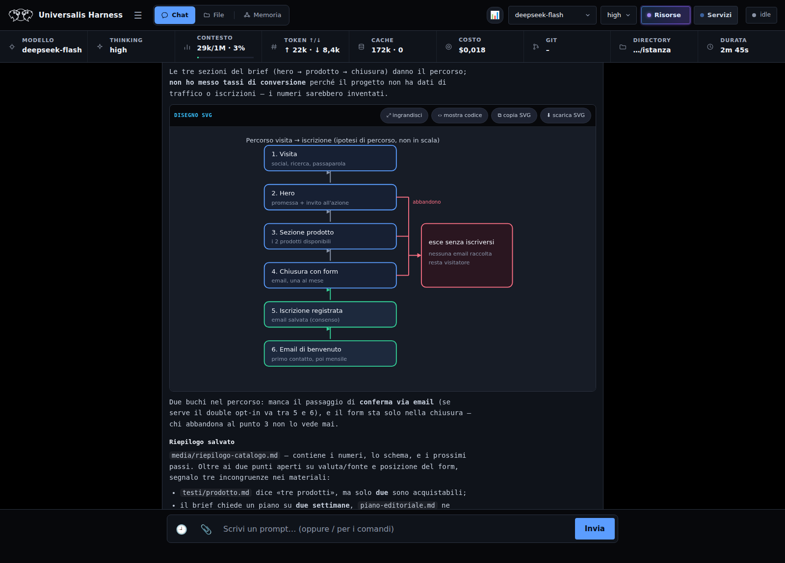

*Un turno vero su un'istanza di esempio: l'agente legge i file del progetto, produce uno schema e
salva un riepilogo. In alto, sempre visibili: modello, livello di ragionamento, contesto occupato,
token in ingresso e uscita, cache, **costo della sessione**, branch git, cartella di lavoro, durata.*

---

## Indice

- [Che cosa risolve](#che-cosa-risolve)
- [Un turno dall'interno](#un-turno-dallinterno)
- [Le capacità, una per una](#le-capacità-una-per-una)
- [Architettura](#architettura)
- [Context engineering: quanto contesto costa una risposta](#context-engineering-quanto-contesto-costa-una-risposta)
- [Decisioni di progetto e che cosa è stato scartato](#decisioni-di-progetto-e-che-cosa-è-stato-scartato)
- [Numeri del repository](#numeri-del-repository)
- [Che cosa si vede del mestiere](#che-cosa-si-vede-del-mestiere)
- [Sicurezza](#sicurezza)
- [Qualità: come si verifica](#qualità-come-si-verifica)
- [Comandi e API](#comandi-e-api)
- [Due modi di usarlo](#due-modi-di-usarlo)
- [Requisiti](#requisiti)
- [Documentazione](#documentazione)
- [Limiti dichiarati](#limiti-dichiarati)
- [Stato e direzioni](#stato-e-direzioni)
- [Licenza](#licenza)

---

## Che cosa risolve

Le interfacce di chat AI ragionano su ciò che incolli. Un agente che lavora davvero deve invece
**vedere le cartelle giuste, toccare i file, ricordare cosa ha fatto ieri e dire quanto è costato**.
Questo progetto è la parte noiosa e difficile di quel salto, fatta in modo verificabile:

| | Una chat web | Universalis Harness | Che cosa cambia in pratica |
|---|---|---|---|
| Dove lavora | nel testo della conversazione | nelle cartelle dell'istanza, con confini di percorso | «sistema il preventivo» significa aprire il file, non riscriverlo a mano |
| Quanto costa | lo scopri alla fine del mese | token, cache e **costo per turno** nella barra, sempre | un turno caro si riconosce subito, non a consuntivo |
| Che cosa ha fatto | una risposta | pensiero, tool call ed esito di ognuna, **nell'ordine reale** | quando sbaglia si vede *dove*, non solo *che* |
| Memoria | si perde con la sessione | episodi, decisioni e artefatti in un grafo consultabile | «cosa avevamo deciso su X» è una domanda con risposta |
| Ripetibilità | dipende dal prompt del giorno | skill nel formato aperto *Agent Skills*, caricate solo quando servono | le procedure diventano stabili e condivisibili |
| Automazione | nessuna | pianificazioni cron che eseguono prompt o obiettivi interi | il lavoro periodico gira anche a dashboard chiusa |

Non è un prototipo: nasce come strumento di lavoro quotidiano, con istanze in uso e un
sottocliente servito dalla stessa base di codice. La sezione [Limiti dichiarati](#limiti-dichiarati)
dice con la stessa chiarezza che cosa **non** è.

---

## Un turno dall'interno

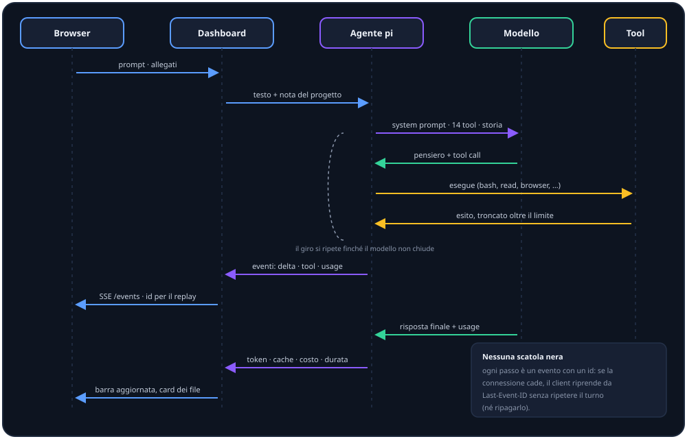

1. Il browser invia il prompt (`POST /api/prompt`) con eventuali allegati; la dashboard aggiunge la
   **nota del progetto** — le cartelle segnate dall'utente — e costruisce il payload.
2. L'agente chiama il modello con system prompt, definizioni dei tool e storia della sessione.
3. Il modello risponde con pensiero e tool call; l'agente esegue, tronca gli esiti troppo lunghi e
   richiama il modello. Il giro si ripete finché il modello non chiude.
4. Ogni passo è un **evento SSE con identificatore**: se la connessione cade, il client riprende da
   `Last-Event-ID` senza rifare il turno (e senza ripagarlo).
5. A fine turno arrivano stato e misure: token in ingresso e uscita, `cacheRead`/`cacheWrite`,
   **costo**, durata. È il numero che si vede nella barra in alto.

I file prodotti compaiono in chat come card con *apri* e *scarica*; i disegni SVG diventano immagini
nel punto esatto del messaggio; la barra dei costi si aggiorna senza ricaricare la pagina.

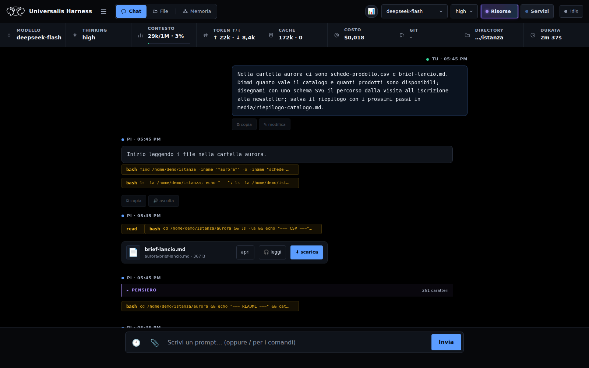

---

## Le capacità, una per una

### Chat agentica trasparente

Pensiero, testo e chiamate ai tool nello stesso flusso, con l'esito di ognuna. Il pannello in alto
mostra modello e livello di ragionamento, contesto occupato sul totale, token in ingresso/uscita,
letture e scritture di cache, **costo della sessione**, branch git, cartella di lavoro, durata.
Strumenti utili quando una risposta costa più del previsto:

- **`/status`** riassume modello, thinking, contesto, token e costi della sessione;
- la vista *contesto* bilancia system prompt, tool, storia e allegati e segnala lo **spreco di cache**
  (quando il prefisso si rompe, il provider ri-fattura a prezzo pieno);
- `/compact` compatta la sessione conservando il riassunto come episodio di memoria;
- modifica e rigenerazione di un messaggio sono azioni di prima classe, non un trucco di UI.

### File e progetto

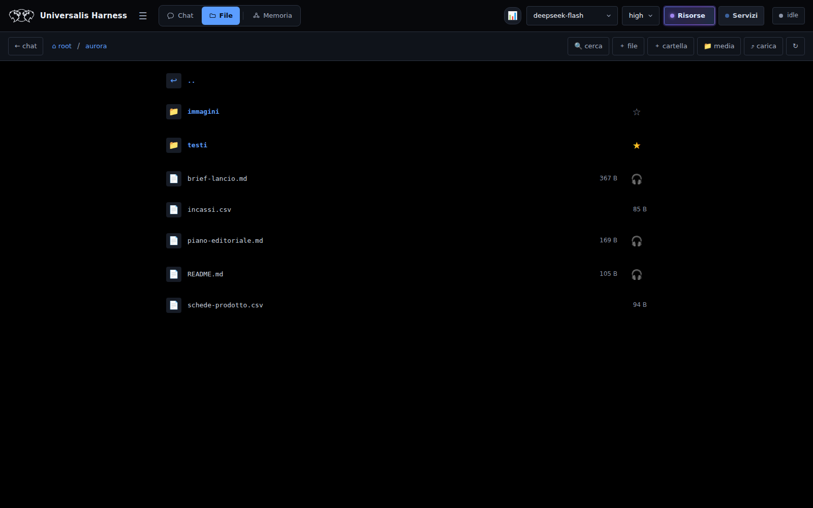

Il file manager naviga, modifica, carica, cerca **nel contenuto** con salto alla riga trovata e si
aggiorna da solo quando l'agente scrive. Le cartelle si scaricano come `.zip` (con i confini di
percorso verificati anche dentro l'archivio).

L'idea che tiene insieme il resto: **il progetto sono le cartelle che scegli tu**. Segnandole con la
stella diventano il contesto stabile dell'agente — sa dove sono, cosa contengono e su quale stai
lavorando, quindi «lavora sul progetto» ha un significato senza rispiegarlo ogni volta.

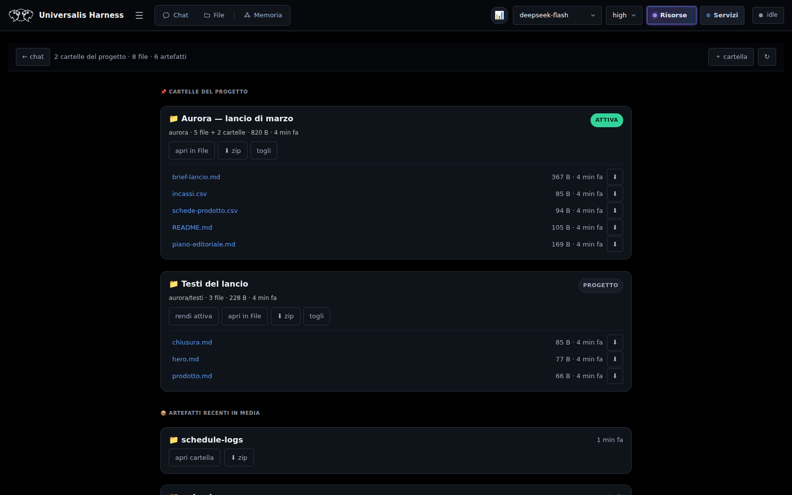

### Immagini, PDF e disegni

- **Immagini**: l'agente le *vede* e le **mostra** con anteprima nel punto del messaggio, nome,
  formato, pixel reali e didascalia. Il formato è verificato dal server sui magic number (un HTML
  rinominato `.png` viene rifiutato); si mostrano solo file locali. Il lettore ha galleria, zoom,
  rotazione, schermo intero e scorciatoie da tastiera.
- **PDF**: prima pagina nella card, poi lettore a pagine con zoom. L'agente li legge **una pagina
  alla volta, una fascia, o cercando dentro** — senza incollare centinaia di pagine nel contesto e
  senza mandarle fuori. Una scansione senza testo si guarda come immagine, e lo dichiara. Il testo
  estratto arriva marcato come *materiale da leggere, non istruzioni da eseguire*.
- **Disegni**: se il modello spiega con uno schema, il blocco SVG diventa un disegno vero, con vista
  ingrandita, copia e download, dopo il passaggio in un sanitizzatore che rifiuta script, risorse
  esterne, `foreignObject` e riferimenti di rete.

### Ascoltare invece di leggere

Sotto ogni risposta c'è 🔊 *ascolta*; nel file manager ogni `.md` ha 🎧 che apre un lettore a schermo
intero con il paragrafo in ascolto evidenziato, salto cliccando e velocità 0,75×–2×. La voce è **sul
server** (piper, voci neurali italiane, offline): nessun servizio cloud, nessun costo a consumo, e la
traccia generata resta in cache — riascoltare è istantaneo. Un capitolo diventa un `.mp3`
scaricabile con un clic.

### Obiettivi e pianificazioni

| Obiettivi | Pianificazioni |
|---|---|
| 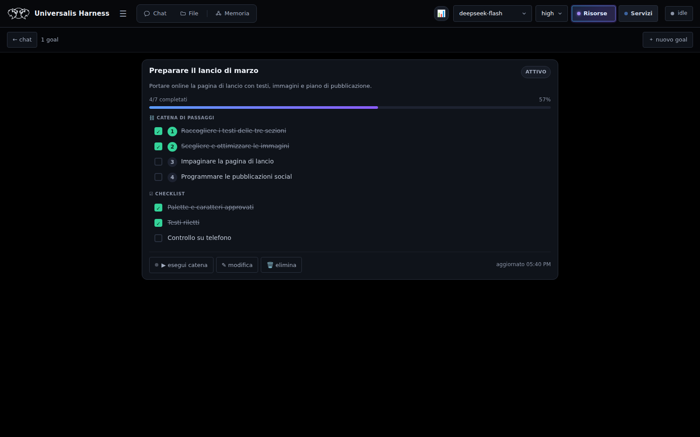 | 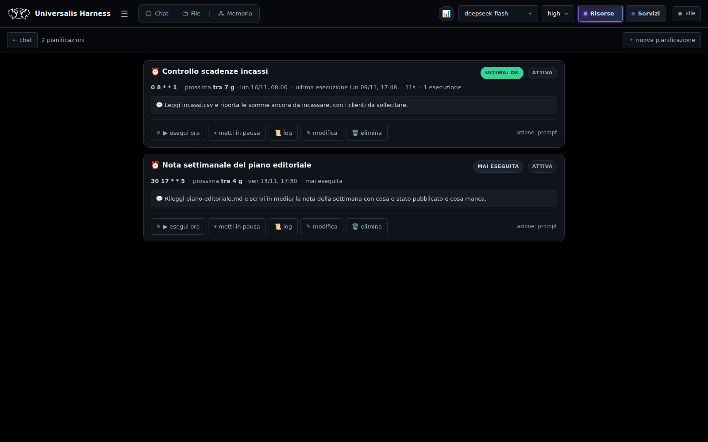 |

Un obiettivo è una **catena di passaggi** più una checklist, con avanzamento e un pulsante che manda
all'agente i passaggi rimanenti. Le pianificazioni cron eseguono prompt o obiettivi interi in
autonomia, con esito, durata, numero di esecuzioni e log consultabile: lo screenshot qui sopra è
un'esecuzione reale (`ULTIMA: OK`, 11 s) fatta girare per documentare la funzione.

### Skill: procedure stabili, non prompt improvvisati

Le skill seguono il formato aperto **Agent Skills** (`SKILL.md` con frontmatter `name` +
`description`): si creano, si importano da `.zip` e si usano come procedure; il modello legge il
corpo **solo quando il compito corrisponde**, perché in contesto c'è solo la descrizione. Le 32
skill incluse coprono:

| Area | Skill |
|---|---|
| Metodo e harness | `creare-skill`, `memoria`, `obiettivi`, `spazio-di-lavoro`, `design-craft`, `report-dataviz`, `visual-representation` |
| Documenti e dati | `documenti` (Word, Excel, PowerPoint, PDF), `immagini` |
| Web e ricerca | `browser` |
| Video e grafica | `video`, `hyperframes` + 8 sotto-skill (`core`, `animation`, `creative`, `keyframes`, `audio`, `registry`, `studio`, `cli`), `motion-graphics`, `general-video`, `product-launch-video`, `faceless-explainer`, `media-use` |
| Social | `social-connect`, `social-publish` |
| Altro | `giochi`, `rea-cli` (reverse engineering di artefatti), `bookforge` (libri), `decision-m`, `timestral` |

### Memoria a lungo termine, a tre costi

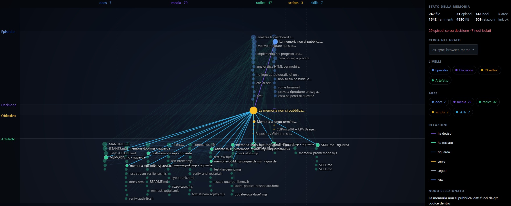

L'harness ricorda il lavoro fatto — episodi, decisioni, file toccati, obiettivi — e lo rende
consultabile a tre prezzi dichiarati:

| Accesso | Che cosa restituisce | Costo tipico |
|---|---|---|
| **grafo** | struttura: nomi e relazioni, senza testo | ~300 token |
| **wiki** | una pagina per nodo: cos'è e i collegamenti nei due versi | ~500 token |
| **ricerca** | frammenti pertinenti con giudizio di **confidenza** e ambito (`[episodio]`, `[codice]`, `[media]`, `[skill]`) | qualche centinaio di token |

Ogni frammento dice **da dove viene** e **quanto fidarsi**; quando la memoria non sa, lo dice invece
di dedurlo. Gli episodi nascono da sé a fine turno, alla compattazione e alla chiusura di una chat.
La scheda Memoria disegna il grafo come mappa 2D (righe = livelli, colonne = progetti) con pan, zoom,
nomi leggibili e una lettura in orbita 3D: canvas scritto a mano, zero librerie, deterministico — così
i **buchi** si vedono (una colonna vuota è un progetto di cui non si registra nulla). I dati non si
pubblicano mai: il repository è pubblico, la memoria no ([docs/MEMORIA.md](docs/MEMORIA.md)).

### Servizi locali, accesi a richiesta

| Risorse | Servizi |
|---|---|
| 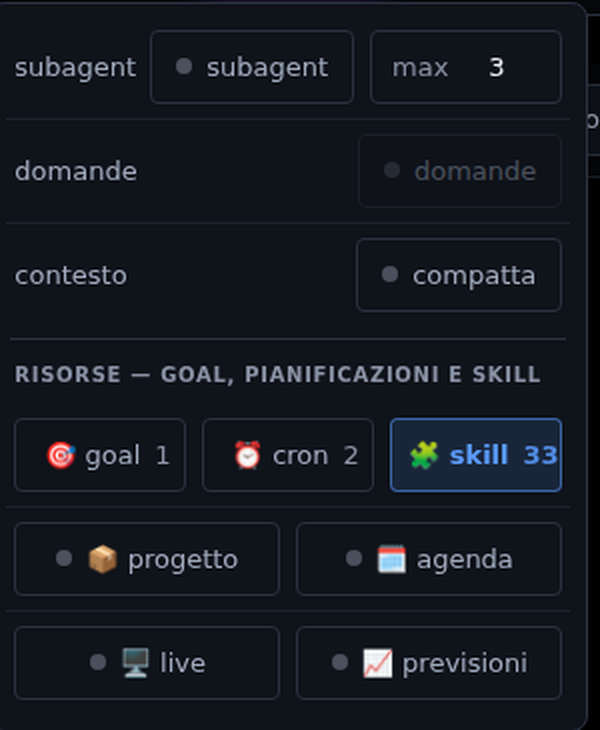 | 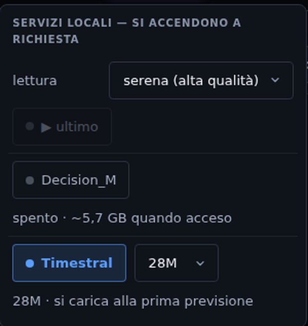 |

- **Decision_M** — decisore tipizzato locale (4B su CPU): risponde a domande sì/no, scelta e
  punteggio **con una probabilità, senza generare un token**. Serve per i giudizi ripetibili
  (instradare, filtrare, dare priorità). Costa ~5,7 GB di RAM: si accende quando serve e l'agente può
  proporne l'uso, mai deciderlo da solo.
- **Timestral** — modello di previsione su serie temporali (28M, CPU): dato il passato di una serie
  restituisce mediana e quantili. È una **stima probabilistica** di un modello pre-addestrato: non
  conosce notizie né eventi annunciati, e l'output lo dichiara.
- **piper** — sintesi vocale neurale offline per l'ascolto.

Il criterio è lo stesso dei tool: **quello che pesa in RAM o in contesto lo paga solo il turno che lo
usa.**

### Browser pilotato e pubblicazione

- L'agente apre siti reali, legge l'albero di accessibilità, clicca e compila moduli in un Chrome
  headless con sandbox verificata prima di ogni azione. Nella vista **live** lo guardi lavorare e, se
  serve un 2FA o un CAPTCHA, prendi il controllo mantenendo la chat accanto; da telefono il riquadro
  si ingrandisce (1:1, 2×) o va a schermo intero.
- Su una Pagina Facebook autorizzata pubblica testo e immagini con le **Pages API ufficiali**: nessun
  browser pilotato, nessun anti-bot da aggirare, nessuna password condivisa. Ogni persona collega i
  propri canali in un profilo separato (`social/<nome>.env`, fuori dal repository, permessi `600`).

### Domande all'utente invece di supposizioni

Quando una richiesta è ambigua l'agente pone la domanda **dentro la conversazione**, con opzioni
concrete e una scadenza esplicita, e aspetta la risposta. Se nessuno risponde, il turno non resta
bloccato: prosegue dichiarando l'assunzione.

### Sul telefono

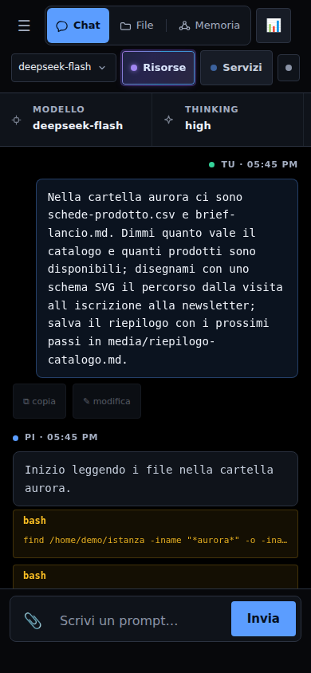

PWA installabile, barra delle statistiche compatta, vista live a schermo intero, lettori con gesti
(doppio tocco, due dita). Le misure e i contrasti sono documentati in
[docs/INTERFACCIA.md](docs/INTERFACCIA.md).

---

## Architettura

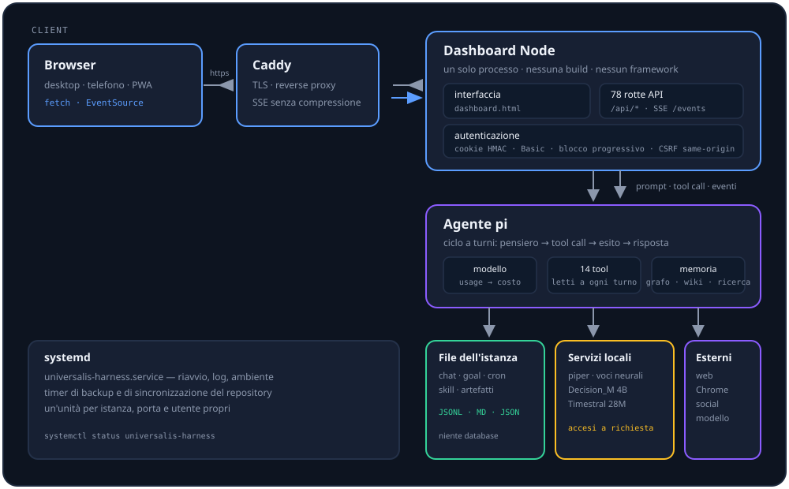

| Componente | Che cosa fa | Perché così |
|---|---|---|
| **Caddy** | HTTPS, reverse proxy, stream SSE non compresso | un turno lungo non deve arrivare a blocchi |
| **Dashboard Node** | interfaccia, 78 rotte API e stream di eventi in un processo | nessuna build, nessun framework: si distribuisce copiando cartelle |
| **Agente pi** | ciclo a turni, tool, estensioni (web, subagent, browser) | il motore è separato dal prodotto e aggiornabile |
| **File dell'istanza** | chat, obiettivi, pianificazioni, skill, artefatti | nessun database: `git diff`, backup e ispezione banali |
| **Servizi locali** | piper, Decision_M, Timestral | voce e giudizi senza mandare dati fuori |
| **systemd** | avvio, riavvio, log, timer di backup e sincronizzazione | un'unità per istanza, porta e utente propri |

Nessun servizio esterno obbligatorio, nessun database, nessuna dipendenza cloud: la macchina (o il
container) è il confine di sicurezza.

---

## Context engineering: quanto contesto costa una risposta

Ogni turno si paga in token, e la parte che paghi **prima di scrivere** è quella che non vedi.
L'harness la misura e la tiene sotto controllo:

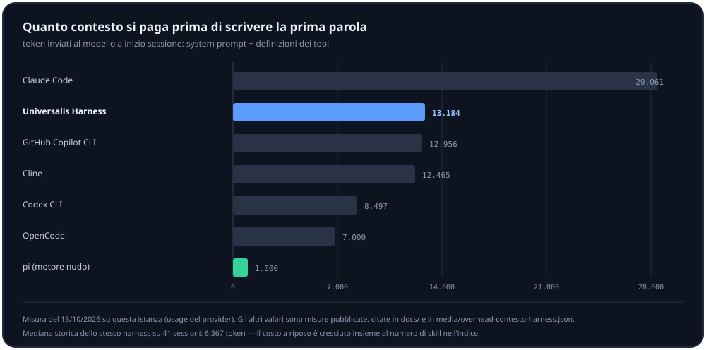

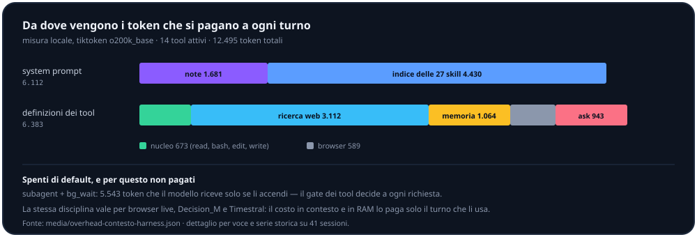

Misure reali, non stime: `usage` del provider al primo turno, meno i token del primo messaggio
dell'utente. Mediana storica su 41 sessioni: **6.367 token**; misura del 13/10/2026: **13.184**,
cresciuta insieme all'indice delle skill. Il confronto con gli altri harness usa misure pubblicate e
citate ([`media/overhead-contesto-harness.json`](media/overhead-contesto-harness.json)); non è una
gara: è il numero che decide quanto costa una conversazione lunga.

Le leve che l'harness usa per non gonfiare quel numero:

1. **Gate dei tool.** Subagent e `bg_wait` (5.543 token di definizioni) non entrano nel prompt se non
   sono accesi; lo stesso vale per browser live e servizi locali.
2. **Indice delle skill, non corpo.** In contesto c'è solo la descrizione; il `SKILL.md` si legge
   quando il compito corrisponde.
3. **Cache stabile.** Il prefisso (system prompt + tool + indice) resta identico tra i turni, così il
   provider lo rilegge dalla cache: la barra mostra letture e scritture separatamente.
4. **Esiti troncati.** Un `bash` che stampa 3 MB non deve costare 3 MB di contesto.
5. **Memoria a tre costi.** Si sceglie *quanto* contesto pagare per rispondere (vedi sopra).
6. **Compattazione con riassunto.** Quando la sessione si allunga, il riassunto non sparisce: diventa
   un episodio.

Il bilancio completo, con lo spreco di cache e le classi di errore, è verificato da
`media/test-contesto.mjs`.

---

## Decisioni di progetto e che cosa è stato scartato

La parte che di solito non finisce in un README, e che spiega il resto.

| Decisione | Perché | Che cosa è stato scartato |
|---|---|---|
| **Nessun database** | lo stato è leggibile, `git diff` funziona, il backup è `tar`, il ripristino non richiede un DBA | Postgres/SQLite: migrazioni e dump per un'applicazione a una persona per istanza |
| **SSE invece di WebSocket** | il flusso è a senso unico, sopravvive ai proxy, e con `Last-Event-ID` si riprende senza rifare il turno | WebSocket: stato in più, riconnessione da reinventare |
| **Un solo processo, niente build** | si distribuisce copiando una cartella; leggere il codice in produzione è possibile | bundler e framework: un passo in più tra il bug e chi lo corregge |
| **Costo sempre in vista** | il costo è un fatto del prodotto, non una sorpresa a fine mese | contatori nascosti dietro un menu |
| **SVG sanitizzato e reso come immagine** | il modello produce contenuto non attendibile: non deve poter toccare il DOM | inserire l'SVG nel DOM «tanto viene dal modello» |
| **Servizi pesanti a richiesta** | 5,7 GB di RAM non possono stare sempre accesi su una macchina condivisa | tutto caricato all'avvio, per comodità |
| **Memoria a tre costi dichiarati** | rispondere «non lo so» costa zero, e a volte è la risposta giusta | ricerche semantiche sempre accese, senza dire quanto costano |
| **Domande con scadenza** | un agente che aspetta un umano assente è un turno perso | attesa infinita di conferma |
| **Un'istanza per persona** | isolamento semplice: cartella, credenziali, quote e limiti per istanza | multi-utente con ruoli: complessità che il prodotto non chiede |

---

## Numeri del repository

| | Valore | Come si conta |
|---|---|---|
| Codice dell'applicazione | **20.055 righe** in tre file | `dashboard.mjs` 6.691 · `dashboard.html` 13.121 · `harness.mjs` 243 |
| Rotte API | **78** | percorsi `/api/*` distinti |
| Comandi in chat | **27** in 5 gruppi | `/help` li elenca tutti |
| Capacità dichiarate da `/api/health` | **27** | così la dashboard e i test sanno che cosa aspettarsi |
| Skill incluse | **32** | una cartella con `SKILL.md` ciascuna |
| Tool visibili al modello (default) | **14** | misurati, non stimati: due sono spenti di default |
| Test automatici | **oltre 850 controlli** in **54 file** e **24 blocchi** di suite | vedi [Qualità](#qualità-come-si-verifica) |
| Dipendenze runtime | **1** (l'SDK dell'agente) | `node_modules/` contiene una sola cartella |
| Contesto a riposo | **13.184 token** (mediana storica 6.367) | `usage` del provider, 41 sessioni |

---

## Che cosa si vede del mestiere

Per chi legge un portfolio: dove sta, nel codice, ciascuna delle cose che un progetto di agenti
serio deve affrontare.

| Area | Dove sta | Che cosa dimostra |
|---|---|---|
| Ciclo dell'agente e tool calling | `dashboard.mjs`, estensioni in `media/` | controllo del turno, gate dinamico dei tool, esiti troncati, stop e ripresa |
| Streaming e resilienza | `/events`, `test-stream-*` | SSE con replay, riconnessione a metà risposta, nessun doppio addebito |
| Context engineering | `test-contesto.mjs`, `overhead-contesto-harness.json` | misura del contesto a riposo, bilancio per voce, spreco di cache, compattazione |
| Valutazione | `media/test-all.sh` e 54 file | test su istanza isolata, browser vero, regressione, sicurezza |
| Prompt injection e contenuto non attendibile | sanitizzatore SVG, marcatura del testo estratto | il modello non scrive nel DOM e ciò che legge non diventa un ordine |
| Servizi locali e costi | `decision_m`, `timestral`, pannello *Servizi* | modelli accesi a richiesta, probabilità senza token generati, RAM dichiarata |
| Sicurezza applicativa | auth, CSRF, confini di percorso, gate dei segreti | fail-closed, test che collaudano il gate stesso |
| Operazioni | systemd, backup, quote, `docs/RICOSTRUZIONE.md` | un prodotto che si installa, si limita e si ripristina |

---

## Sicurezza

| Garantito | Come |
|---|---|
| Accesso protetto | login con cookie firmato (HMAC) **o** Basic Auth; blocco progressivo dopo tentativi falliti; HTTPS obbligatorio in produzione |
| CSRF | le scritture da cookie sono accettate solo dall'origine dell'applicazione |
| Perimetro dei file | percorsi confinati nella root, `..` e link simbolici che ne escono bloccati — anche nello `.zip` di una cartella |
| Contenuto non attendibile | l'SVG del modello passa da un sanitizzatore con whitelist e viene reso come immagine, mai nel DOM |
| Prompt injection nei documenti | il testo estratto da PDF e immagini arriva marcato come materiale da leggere, non istruzioni da eseguire |
| Browser | sandbox di Chrome verificata prima di ogni azione, utente di sistema dedicato, nessuna shell |
| Segreti fuori dal codice | credenziali in `.env` con permessi ristretti, segreto di sessione in file separato, esclusi dal versionamento |
| Pubblicazione senza segreti | `scripts/sync-fine-lavoro.sh` ferma il commit (esce 2, fail-closed) se nell'elenco c'è un percorso riservato; `scripts/preflight-sicurezza.sh` guarda ciò che è già nella storia e i permessi locali |

Le regole stanno in `scripts/riservati.pattern` e `scripts/segreti.pattern` e sono collaudate da
`scripts/test-gate-sicurezza.sh`; il ragionamento e i limiti in [docs/SICUREZZA.md](docs/SICUREZZA.md).

---

## Qualità: come si verifica

La suite principale attraversa 24 blocchi; ogni blocco è un file di test che parla con **un'istanza
isolata** (porta, cartella sessioni e segreto propri), non con la produzione.

| Blocco | Che cosa verifica |
|---|---|
| statici | coerenza fra HTML e server: ogni elemento della UI ha il suo endpoint, e viceversa |
| sintassi | il JavaScript dentro `dashboard.html` è valido (nessuna build, quindi il controllo è esplicito) |
| skill | frontmatter, routing, collisioni di nome, peso delle descrizioni nel contesto |
| contesto | bilancio dei token, spreco di cache, classi di errore |
| logica UI | notifiche, frecce, snippet: senza aprire un browser |
| stream | caduta della connessione a metà risposta, replay con `Last-Event-ID`, riconnessione live |
| domande | stati, timeout, validazione, segreti che non devono comparire |
| API | auth, rate limit progressivo, PWA, ricerca, export, upload, traversal, symlink |
| funzioni | goal, pianificazioni, skill, browser, contesto |
| browser vero | viste che si aprono e tornano, card dei tool, anteprima dei disegni, palette dei comandi, lettore PDF |
| sicurezza | sanitizzatore SVG, gate dei segreti, hardening degli header |

Comandi: `npm test` per i controlli locali, `bash media/test-all.sh` per la suite completa. I test che
aprono un browser vero usano Chrome headless e girano sulla stessa macchina, senza servizi esterni.

---

## Comandi e API

**27 comandi** in chat, in cinque gruppi (`/help` mostra la sintassi di ognuno):

| Gruppo | Comandi |
|---|---|
| sessione | `/help` `/status` `/new` `/sessions` `/rename` `/export` `/compact` `/stop` |
| agente | `/model` `/think` `/subagents` `/subagents-max` `/browser` `/ask` |
| obiettivi | `/goals` `/goal` `/goal-run` `/goal-done` |
| pianificazioni | `/crons` `/cron` `/cron-run` `/cron-toggle` `/cron-del` |
| interfaccia | `/tab` `/skills` `/files` `/clear` |

**78 rotte API**, per area:

| Area | Esempi |
|---|---|
| conversazione | `/api/prompt` `/api/abort` `/api/compact` `/api/messages/edit` `/api/messages/regenerate` |
| eventi | `/events` (SSE con replay), `/api/state` `/api/contesto` |
| file | `/api/files` `/api/file` `/api/file/mkdir` `/api/file/rename` `/api/file/delete` `/api/search/files` `/api/download` `/api/chat/upload` |
| progetto | `/api/progetto` |
| obiettivi e pianificazioni | `/api/goals` `/api/goals/execute` `/api/schedules` `/api/schedules/run` `/api/schedules/log` |
| skill | `/api/skills` `/api/commands` `/api/resolve-files` |
| memoria | `/api/memoria` `/api/memoria/grafo` `/api/memoria/nodo` `/api/memoria/cerca` `/api/memoria/ricostruisci` |
| media | `/api/image` `/api/pdf` `/api/video` |
| browser | `/api/browser/open` `/api/browser/press` `/api/browser/live` `/api/browser/control` |
| servizi | `/api/decision_m` `/api/timestral` |

Gli obiettivi si aggiornano **via API**, non riscrivendo il file: la dashboard tiene lo stato in
memoria e una scrittura a mano verrebbe sovrascritta alla prima azione dalla UI.

---

## Due modi di usarlo

| | Istanza ospitata | Installazione on-premise |
|---|---|---|
| Dove gira | server gestito, una istanza per cliente | macchina del cliente, anche in rete chiusa |
| Isolamento | cartella, credenziali e configurazione proprie; quota disco con avviso **prima** del tetto fisico; modello bloccabile; livelli di ragionamento disabilitabili; sandbox più stretta | lo stesso servizio, con l'utente e le quote che il cliente decide |
| Dati | restano nella cartella dell'istanza | restano in casa |
| Aggiornamenti | a cura di chi ospita | a cura del cliente, con la procedura di [docs/RICOSTRUZIONE.md](docs/RICOSTRUZIONE.md) |
| Fatturazione | gestita a parte (non c'è billing automatico) | licenza |

Dettagli su porte, utenti e limiti per più istanze sullo stesso server in
[docs/ISTANZE.md](docs/ISTANZE.md).

---

## Requisiti

| Componente | Obbligatorio | Note |
|---|---|---|
| Linux con systemd | sì | testato su Node 24, richiede Node ≥ 22 |
| Node.js | sì | nessuna build, nessun transpiler |
| Caddy (o altro reverse proxy) | per HTTPS | non deve comprimere lo stream SSE |
| Chrome headless | no | solo per il tool `browser`, con un utente di sistema dedicato |
| `poppler-utils` | no | lettura dei PDF (`pdfinfo`, `pdftotext`, `pdftocairo`); si disattiva con `DASH_PDF_DISABLED=1` |
| piper + `ffmpeg` | no | lettura ad alta voce; senza, la dashboard dice «motore di lettura non disponibile» |
| Decision_M · Timestral | no | servizi locali, accesi dal pannello *Servizi* |

---

## Documentazione

| dove | cosa |
|---|---|
| [`docs/MANUALE.md`](docs/MANUALE.md) | guida operativa completa: chat, file manager, viste, comandi, API, sicurezza, backup, test |
| [`docs/MEMORIA.md`](docs/MEMORIA.md) | episodi, grafo, wiki, ricerca e che cosa non viene mai pubblicato |
| [`docs/TIMESTRAL.md`](docs/TIMESTRAL.md) | previsioni su serie temporali: metodo, backtest, limiti |
| [`docs/ISTANZE.md`](docs/ISTANZE.md) | più istanze sullo stesso server: porte, utenti, limiti, isolamento |
| [`docs/RICOSTRUZIONE.md`](docs/RICOSTRUZIONE.md) | ripristino da zero: prerequisiti, servizi, quote, sandbox |
| [`docs/SICUREZZA.md`](docs/SICUREZZA.md) | controlli contro i segreti e che cosa un esito verde **non** dice |
| [`docs/SYNC-GITHUB.md`](docs/SYNC-GITHUB.md) | cosa viene pubblicato in questo repository e cosa resta fuori |
| [`docs/INTERFACCIA.md`](docs/INTERFACCIA.md) | sistema visivo: token, contrasti, misure su telefono |

### Che cosa c'è in questo repository

| percorso | contenuto |
|---|---|
| `dashboard.mjs` | server HTTP, API, SSE, autenticazione, gate dei tool, memoria, voce, PDF |
| `dashboard.html` | interfaccia completa (HTML, CSS, JS) senza build |
| `harness.mjs` | lo stesso agente a riga di comando, con i comandi `/think` e `/model` |
| `skills/` | le 32 skill in formato Agent Skills |
| `scripts/` | gate di pubblicazione, preflight di sicurezza, backup, sincronizzazione, servizi |
| `media/` | test, misure (contesto, backtest), artefatti e materiali di lavoro |
| `docs/` | manuale e documenti di progetto |

### Come sono fatte le figure

Gli screenshot sono presi da un'**istanza di esempio** su una cartella di prova (`aurora/`), con dati
inventati: nessun file, cliente o conversazione reale compare in questo README. Le cifre nelle
tavole (token, costi, durate) sono quelle di quei turni; i due turni della chat sono stati eseguiti
davvero con il modello, non simulati. Gli schemi sono SVG scritti a mano, con la stessa palette
dell'interfaccia; il grafico del contesto legge i dati misurati in
[`media/overhead-contesto-harness.json`](media/overhead-contesto-harness.json).

---

## Limiti dichiarati

**Limiti di modello di sicurezza.** L'agente ha accesso a una shell e ai file della root
dell'istanza: il confine è la macchina (o il container) su cui gira, non l'applicazione. Il modello
di accesso è pensato per **una persona per istanza** (utente e password), non per organizzazioni con
ruoli e permessi. Nella modalità ospitata non c'è fatturazione automatica.

**Limiti di accuratezza, dichiarati dall'agente stesso.** Decision_M e Timestral producono
probabilità e quantili che **non sono calibrati**: buoni per ordinare e per soglie prudenti, non come
frequenze esatte. Timestral non conosce notizie né eventi annunciati. La memoria, quando non sa,
risponde che non sa: «confidenza bassa» è un'informazione, non un difetto da nascondere.

**Limiti di prodotto, oggi.** Le integrazioni con servizi esterni sono quelle con API ufficiali
(ricerca web, Pages API di Meta): niente scraping di social o di siti che lo vietano. Non c'è
un'app mobile nativa: c'è una PWA. Non c'è multi-utente con ruoli.

---

## Stato e direzioni

Prodotto **in uso quotidiano**, in evoluzione attiva.

| Pronto e stabile | In evoluzione |
|---|---|
| chat, file manager, progetto, obiettivi, pianificazioni, skill, memoria, domande all'utente, disegni, immagini, PDF, voce, export, PWA, multi-istanza con limiti, browser pilotato, pubblicazione social | integrazioni con altri servizi esterni, ciclo di vita delle istanze ospitate, affinamento dell'interfaccia, riduzione del contesto a riposo |

Il metodo è lo stesso che ha prodotto questo README: misurare, scrivere il numero accanto
all'affermazione, e tenere un test che se ne accorga se il numero cambia.

---

## Licenza

**Software proprietario — tutti i diritti riservati.** Il codice è pubblicato per trasparenza e
valutazione; non è concesso in uso, copia, modifica o ridistribuzione senza un accordo scritto con il
titolare dei diritti. Vedi [`LICENSE`](LICENSE). Licenze d'uso commerciale, istanze ospitate e
installazioni on-premise sono disponibili su richiesta.
