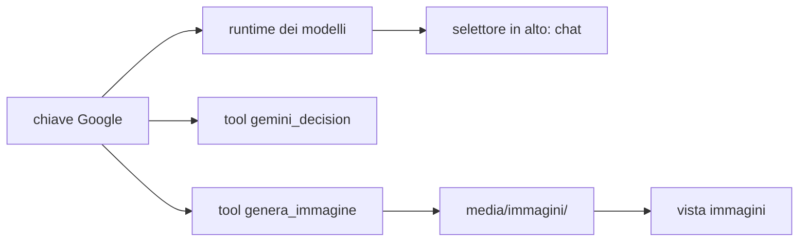

# Provider Google (Gemini): chat, classificatore, immagini

Questa guida descrive l'integrazione di **Google AI Studio** accanto a DeepSeek: modelli di chat
selezionabili in alto, classificatore tipizzato (`gemini-decision-1`) e generazione di immagini
(Nano Banana). È scritta per due lettori: chi amministra questa istanza e **chi scarica l'harness
da GitHub e deve mettere le proprie chiavi**.

---

## 1. Cosa aggiunge

| Capacità | Modello | Come si usa | Costo |
|---|---|---|---|
| Chat | Gemini 3.8 Flash, 3.1 Pro, Flash-Lite, Gemma 4… | selettore in alto, come DeepSeek | per token (listino Google) |
| Classificatore | `gemini-decision-1` | tool `gemini_decision` in chat | solo token di input (~200 token per uno stato breve), **0 token di output** |
| Immagini | `gemini-3.1-flash-lite-image` (default), `gemini-3.1-flash-image`, `gemini-3-pro-image` | tool `genera_immagine` e vista «🎨 immagini» | per immagine: ~$0,034 / ~$0,067 / ~$0,134 |



> Il diagramma è concettuale, non in scala.

---

## 2. Configurare la chiave (una volta)

La chiave si crea in [Google AI Studio](https://aistudio.google.com/apikey). Poi, in **uno** di
questi due modi:

### a) file `.env` dell'istanza (quello che usa systemd)

```bash
GEMINI_API_KEY=...
```

`.env` è **ignorato da git**: non finisce nel repository. Dopo la modifica:

```bash
scripts/restart-dashboard.sh
```

### b) pannello «🔑 chiavi» della dashboard

Menu «Servizi» → **🔑 chiavi** → incolla la chiave → «verifica e salva». La chiave viene provata
con una chiamata di sola lettura *prima* di essere scritta, e finisce in
`~/.pi/agent/auth.json` con permessi `600` — **fuori dal repository**.

Il pannello mostra sempre solo: se la chiave c'è, da dove arriva (`env` o `auth.json`) e le ultime
4 cifre. Il valore non viene mai rimandato al browser.

---

## 3. Onboarding di una copia nuova (chi scarica l'harness)

```bash
git clone … && cd pi-harness
npm install

# 1. la propria chiave
cp .env.example .env        # se presente; altrimenti crea .env a mano
#   GEMINI_API_KEY=...        (Google, opzionale: chat + classificatore + immagini)
#   DEEPSEEK_API_KEY=...      (DeepSeek, opzionale: chat)

# 2. il provider nel runtime (idempotente, non distruttivo)
node scripts/onboarding-provider.mjs --google
node scripts/onboarding-provider.mjs --tutto     # oppure tutti i provider

# 3. la chiave funziona davvero?
node scripts/onboarding-provider.mjs --verifica

# 4. avvio
node dashboard.mjs --port 8420 --root "$PWD"
```

`onboarding-provider.mjs` senza argomenti stampa **cosa manca e cosa fare**. Nel file
`~/.pi/agent/models.json` scrive un *riferimento* (`"apiKey": "$GEMINI_API_KEY"`), mai la chiave:
quel file si può copiare, mostrare o versionare senza conseguenze.

Senza chiave Google l'harness funziona lo stesso: i modelli Google non compaiono nel selettore e i
due tool (`gemini_decision`, `genera_immagine`) non vengono inviati al modello.

---

## 4. Modelli nel selettore

Il selettore in alto elenca i modelli **conversazionali** con credenziali configurate, con il nome
commerciale (l'id resta nel `title`). Sono esclusi i modelli che non sono da chat — immagini, TTS,
live, embedding, computer-use — perché sceglierli romperebbe la sessione.

L'ordine mette prima il provider che sta lavorando, poi i modelli consigliati
(`media/providers.mjs`, `CONSIGLIATI`). Per aggiungerne o nasconderne uno si cambia quella lista:
è codice, quindi versionato.

I costi per token non sono scritti a mano: arrivano dal catalogo del runtime
(`@earendil-works/pi-coding-agent`), che li conosce. Se un modello non ha prezzo nel catalogo, la
dashboard **non inventa** una cifra.

---

## 5. Classificatore (Gemini Decision 1)

`POST /v1beta/decisions` — un input condiviso, da 1 a 1000 domande tipizzate, probabilità
calibrate e **zero token di output**.

```json
{
  "model": "gemini-decision-1",
  "input": "Il pacco è arrivato rotto e mancava un pezzo.",
  "questions": {
    "rotto":   { "type": "noul",   "instructions": "Il cliente segnala un danno?" },
    "reparto": { "type": "choice", "instructions": "A chi va?",
                 "criteria": { "rimborso": "danno prodotto", "spedizione": "consegna" } },
    "gravita": { "type": "score",  "instructions": "Quanto è grave?",
                 "criteria": ["Bassa", "Media", "Alta"] }
  }
}
```

Il tool `gemini_decision` accetta le stesse forme comode di Decision_M (`boolean`, `noul`,
`choice` con `options`, `score` con `levels`) e le traduce: un solo dialetto per due motori.

Interruttore: menu «Servizi» → **classificatore**. Spento, il tool sparisce dalla lista inviata al
modello (nessun tentativo a vuoto).

---

## 6. Immagini (Nano Banana)

Modelli e prezzi pubblici (novembre 2026, listino Google; le immagini si pagano a token di output
immagine, quindi il prezzo per immagine è una **stima**):

| id | nome | prezzo indicativo 1K | risoluzioni |
|---|---|---|---|
| `gemini-3.1-flash-lite-image` | Nano Banana 2 Lite | ~$0,0336 | 1K |
| `gemini-3.1-flash-image` | Nano Banana 2 | ~$0,067 | 1K, 2K, 4K |
| `gemini-3-pro-image` | Nano Banana Pro | ~$0,134 (4K ~$0,24) | 1K, 2K, 4K |

- **Default: il più economico.** La regola vive in una costante (`MODELLO_IMMAGINE_DEFAULT`) e nella
  descrizione del tool, che è ciò che il modello legge.
- La vista «🎨 immagini» (pannello «Risorse») ha prompt, modello, formato, risoluzione, riferimento
  opzionale e la galleria di `media/immagini/`. La scelta del modello si salva in
  `media/immagini-prefs.json` (ignorato da git).
- Ogni generazione, riuscita o no, scrive una riga in `media/immagini/registro.jsonl`: modello,
  formato, byte, millisecondi, costo stimato, esito. È l'unico posto dove il costo delle immagini è
  visibile, perché non passa dai token della chat.
- Le immagini **non hanno piano gratuito**: con una chiave senza fatturazione Google risponde
  `429 RESOURCE_EXHAUSTED`. Il messaggio d'errore lo dice.

Esempio diretto:

```bash
node -e 'import("./media/gemini-client.mjs").then(async m=>{
  const r = await m.generaImmagine({prompt:"un quadrato bianco su fondo blu", model:"gemini-3.1-flash-lite-image", formato:"1:1", dimensione:"1K"});
  console.log(r.mime, r.dati.length);
})'
```

---

## 7. Sicurezza: dove può finire una chiave (e dove no)

| Posto | La chiave c'è? | Note |
|---|---|---|
| `.env` dell'istanza | sì | ignorato da git, permessi 600 |
| `~/.pi/agent/auth.json` | sì (se salvata dal pannello) | fuori dal repository, 600 |
| `media/provider-catalogs` / codice | no | solo id, nomi, prezzi pubblici |
| `~/.pi/agent/models.json` | no | solo il riferimento `$GEMINI_API_KEY` |
| repository / GitHub | **no, mai** | `scripts/preflight-sicurezza.sh` cerca i pattern dei segreti in ciò che è versionato |

`scripts/segreti.pattern` riconosce anche il formato nuovo delle chiavi AI Studio (`AQ.…`), oltre a
`AIza…`: preflight e pulizia della memoria usano lo stesso elenco.

**Se una chiave è stata incollata in chat**, quella chiave va considerata esposta: ruotala in AI
Studio. Il messaggio resta nel file della sessione (`sessions/`, ignorato da git) e la memoria a
lungo termine viene ripulita con `scripts/memoria-rimuovi-segreti.sh`.

---

## 8. Diagnostica rapida

```bash
node scripts/onboarding-provider.mjs --verifica   # la chiave risponde?
curl -s -u "$DASH_USER:$DASH_PASSWORD" localhost:8420/api/providers   # stato + impronta
curl -s -u "$DASH_USER:$DASH_PASSWORD" localhost:8420/api/immagini    # prefs + galleria + registro
grep -i "gemini\|immagini" /var/log/… | tail     # oppure: journalctl -u pi-dashboard -n 50
```

Problemi tipici:

| Sintomo | Causa | Rimedio |
|---|---|---|
| Google non compare nel selettore | manca la chiave, o `models.json` non ha il provider | pannello chiavi; `onboarding-provider.mjs --google` |
| `429` sulle immagini | nessuna fatturazione sul progetto | attivarla, oppure usare la chat per descrivere l'immagine |
| `400 INVALID_ARGUMENT` sull'immagine | `imageSize` non supportata dal modello (Lite = solo 1K) | la vista limita già le scelte per modello |
| il tool non c'è ma la chiave c'è | interruttore spento | menu «Servizi» → classificatore / immagini |
